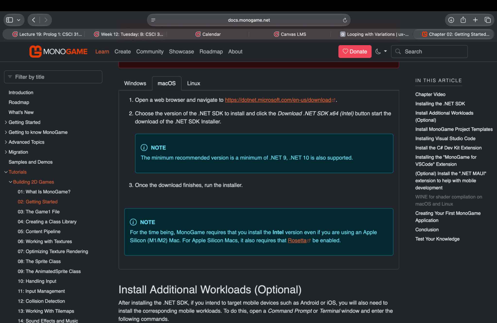
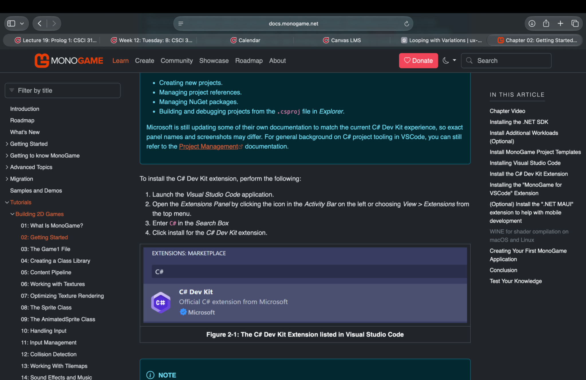
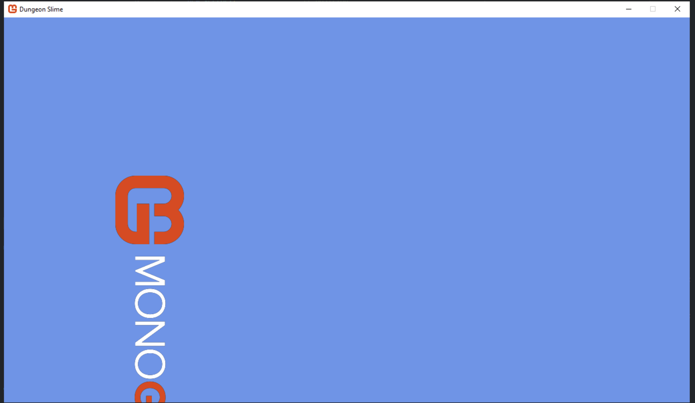
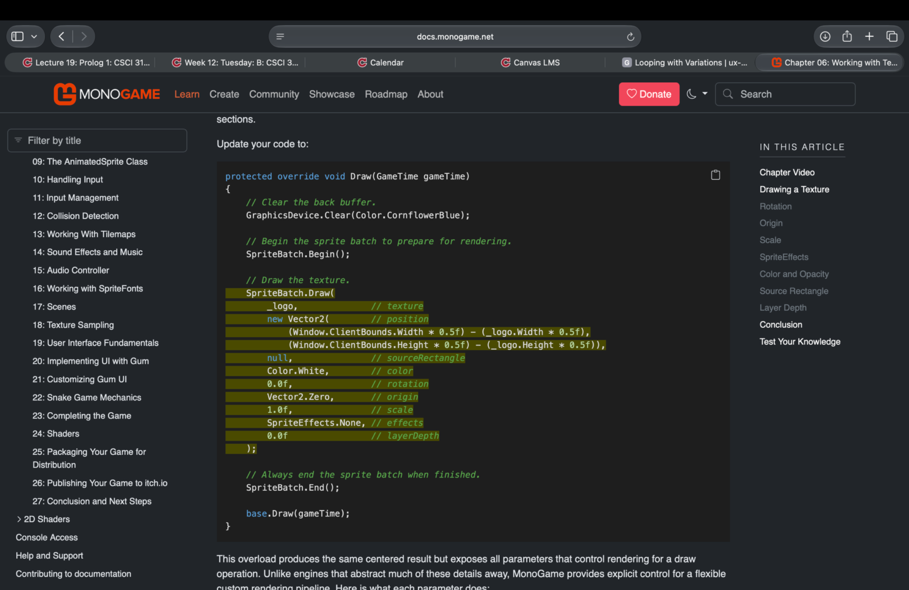

# Learning MonoGame: When Getting Started Becomes the Hardest Part

*My experience learning game development through the official MonoGame Building 2D Games guide.*

## Getting started

Recently, I've been working my way through MonoGame's *Building 2D Games* guide. I've wanted to get more into game development, and MonoGame seemed like a good place to start since it lets you build games directly with C#. I already had programming experience and was familiar with VS Code, so I figured getting everything set up would be fairly straightforward.

Unfortunately, that wasn't quite how things went.

One of the first things I ran into was the guide's setup instructions for macOS. The instructions had me install an Intel version of the .NET tooling and use Rosetta, even though my Mac uses Apple Silicon. It claims that the tutorial isn't fully up to date, and still runs on the intel version but they're working on it. However, since I was following the official guide, I assumed that they knew what they were doing and everything would still be smooth. Boy was I wrong. 

What was supposed to be a straightforward installation turned into a long tediuous back and forth. I had to uninstall extensions, clear out old configuration information, and rework paths just to get things running properly. Some of the other tools the guide recommended installing also caused problems, and I ended up removing those too!

*Figure 1. The guide's macOS setup instructions were where my installation problems began.*

This was the first point where my **mental model** didn't match what actually happened. A mental model is the expectation someone has about how a system will work, and I expected this system to be starightforward and streamlined. It was far from it. 

## Starting over on Windows

Eventually, I switched to my Windows desktop. I thought starting fresh on another machine might be easier, especially since most of my issues were stemming from the fact that I was on MacOs. Unfortunately, I had never really done development on that computer before. I had to install VS Code, clear space on my computer, create a new enviroment, download all new dependencies, basically start from scratch once again. 

At that point, I was learning two things at once: MonoGame AND how to maintain a development environment on two different operating systems. I was switching between computers, checking which tools were installed, figuring out paths, and googling errors that the guide didn't anticipate.

I also ended up relying on the .NET command-line tools for much of the work because I couldn't get the VS Code integration working the way I expected. The command line became the most reliable way to keep moving forward.

*Figure 2. More of the setup process and the configuration steps I had to work through.*

The documentation does offer different workflows for some tasks, which I appreciated. For example, the Content Pipeline section gives options for VS Code, Visual Studio, and the .NET CLI. Having alternatives is useful, especially when one workflow isn't cooperating.

*Figure 3. The guide presents different ways to work with the Content Pipeline.*

This connects to **error recovery**, or how easily someone can get back on track after something goes wrong. Having another way to complete a task helped me continue, but I still had to figure out which option would work with my setup.

The process also added a lot of **cognitive load**. The mental effort required to keep track of what I had done on wich system, and which would be easier to learn whatever concept it was currently on. The guide helped me understand what to install, but it didn't always help me understand what to do when the directions didn't work.

## When things finally started working

I don't want to make it sound like the entire experience has been negative. Once I got everything working, and the tutorials stopped being about downloading new apps and extensions, everything was very fluid. I'm now around Chapter 6, working with texture rendering and learning about sprite batches and their settings, including color, rotation, origin, opacity, and draw order. 

This is where the guide starts to shine. The chapters do a good job introducing concepts in manageable pieces, ideas are kept within their general chapter and they state and if they will expound on more a complex task later. 

*Figure 4. The guide demonstrates drawing a texture in the game window.*

The `SpriteBatch.Draw()` method is a good example. It has several parameters that control how a texture appears, and the tutorial explains what those options do. Being able to experiment with position, rotation, scale, and color makes the material easier to understand. Especially since these settings apply to everything single thing thats going to appear on screen. 

*Figure 5. The SpriteBatch.Draw method exposes several options for controlling how a texture is rendered.*

I started experimenting with the settings myself and ended up with the logo rotated vertically and pushed toward the bottom-left corner of the window. It wasn't what I expected, but unlike the installation problems, this was actually fun to figure out. See everything is given a predetermined origin. So even though you might what to print in the center, its the center of the origin, which could be anywhere. Important to be explicit with your sprites. 

*Figure 6. An unexpected result while I was experimenting with texture positioning and rotation.*

This is a good example of **feedback**. In UX, feedback is the information a system gives after someone takes an action. I could change a value, run the game, and immediately see what happened. Even when the result wasn't what I wanted, I had something visible to learn from.

The guide also supports **learnability**, meaning how easily someone can become comfortable using a system. Each chapter builds on previous concepts, and the examples give me room to experiment without feeling completely lost.

## What could be improved?

Looking back, I think the biggest weakness of my experience was the initial setup. The actual tutorials have been enjoyable and do a good job introducing game development concepts, but getting to that point required more work than I expected.

The setup could be improved with a clearer compatibility check before users install anything. For example, it could make the recommended SDK architecture and version more obvious for each operating system, explain potential conflicts with existing VS Code extensions, and offer more troubleshooting steps for common installation problems.

A short checklist to verify that the development environment is working before starting the tutorials would also help. That could catch configuration problems early, instead of leaving users to discover them while they're trying to follow later chapters.

I also think the alternative workflows are a good idea. Supporting VS Code, Visual Studio, and the .NET CLI gives users flexibility. The guide could make that flexibility more useful by explaining when someone might choose one workflow over another and what to check if their preferred option doesn't work.

## Final thoughts

Overall, I'm really enjoying learning MonoGame. Once I got past the initial setup, the experience became smooth, interesting, and pretty fun. I'm still working through the guide and enjoying seeing how the different pieces of a game come together.

I think that's what makes this a useful UX experience to reflect on. The documentation does a good job teaching the framework itself, but the process of getting everything ready to use it was much harder than it needed to be.

The biggest takeaway for me is that a good tutorial shouldn't just teach someone how to use a framework. It should make getting started accessible enough that the user can actually reach the enjoyable part of learning.

The setup problems didn't take away from how useful the tutorials have been, but they definitely made getting there harder than it needed to be.
